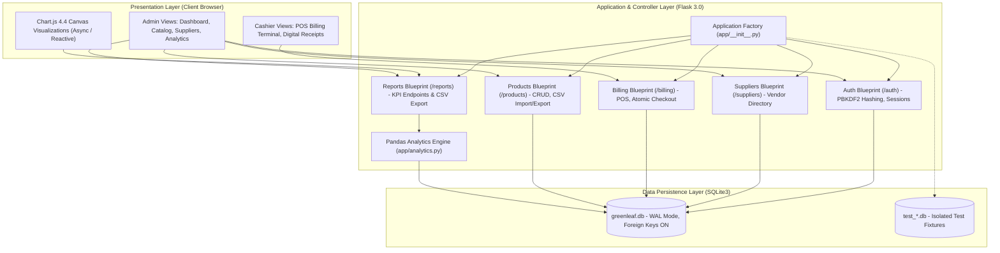
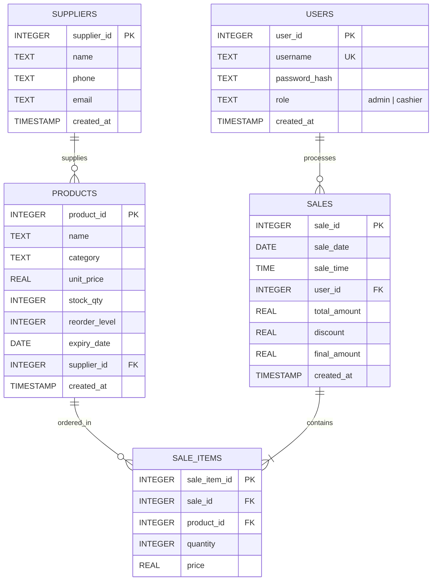

# Internship Project Report: GreenLeaf Grocers
## Inventory & Sales Management System with Analytics Dashboard

---

**Project Title**: Inventory & Sales Management System with Executive Analytics Dashboard  
**Client / Case Study**: GreenLeaf Grocers (Regional Fresh Food & Grocery Retailer)  
**Internship Role**: Python Developer / Data Analyst Intern  
**Program Duration**: 8-Day Intensive Capstone Project  
**Technology Stack**: Python 3.12, Flask 3.0, SQLite3, Pandas 2.2, Chart.js 4.4, Bootstrap 5.3  
**Status**: Completed & Verified (60/60 Automated Tests Passing, 100% Success Rate)  

---

## 1. Executive Summary

### 1.1 Organizational Background
**GreenLeaf Grocers** is a fast-growing neighborhood grocery chain specializing in organic produce, daily dairy, artisanal bakery goods, pantry staples, and beverages. Despite strong customer footfall and quality merchandise, the store operated with manual pen-and-paper ledgers, detached barcode checkouts, and disconnected spreadsheets.

### 1.2 Identified Operational Inefficiencies
1. **Pervasive Stock-Outs**: High-demand perishables (fresh milk, organic greens) frequently ran out during peak shopping hours because store managers lacked real-time stock-level visibility.
2. **High Perishable Spoilage (Shrinkage)**: Expired dairy and produce items were regularly discovered on store shelves rather than discounted or returned to suppliers, incurring preventable capital losses.
3. **Checkout Bottlenecks**: Manual bill calculation and disjointed stock reconciliation created slow customer queues, increasing cashier calculation errors and cart abandonment.
4. **Zero Commercial Intelligence**: Store owners could not analyze weekly sales trends, identify best-selling SKUs, or calculate inventory turnover velocity to guide procurement negotiations.

### 1.3 Implemented Solution
This 8-day engineering initiative delivered an integrated, responsive web application combining:
- A normalized SQLite database maintaining complete referential integrity across users, suppliers, products, and multi-item sales transactions.
- Role-Based Access Control (RBAC) separating administrative store configuration from cashier checkout terminals.
- A real-time inventory engine featuring proactive visual alerts (🔴 Low-Stock and 🟡 Near-Expiry countdown badges) and bidirectional CSV catalog integration.
- An atomic Point of Sale (POS) billing engine that prevents overselling, applies validated promotional discounts, generates printable thermal receipts, and exports financial CSV summaries.
- A high-performance Pandas Analytics Engine calculating 5 core retail KPIs and rendering interactive Chart.js visualizations (sales trends, category share, and dynamically switchable best-seller charts).
- A defensive architecture validated by a master test suite of 60 automated unit tests with 100% pass coverage.

---

## 2. System Architecture & Engineering Design

### 2.1 Architectural Pattern
The application follows the **Model-View-Controller (MVC)** architectural design pattern, implemented through Flask's Application Factory pattern and modular Blueprints:



### 2.2 Modular Blueprint Structure
- **`app/routes/auth.py`**: Controls session initialization, credentials verification, role resolution, and graceful logout.
- **`app/routes/main.py`**: Directs authenticated users to the executive summary dashboard or redirects unauthenticated sessions to the login gateway.
- **`app/routes/products.py`**: Manages the complete product inventory lifecycle, live category filters, search indexing, and bulk CSV ingestion/export.
- **`app/routes/billing.py`**: Drives the live POS interface, cart serialization, atomic checkout transactions, and printable thermal receipt formatting.
- **`app/routes/suppliers.py`**: Manages wholesale agricultural and distributor partners, tracking active item linkages.
- **`app/routes/reports.py`**: Bridges the web interface to the Pandas analytics engine, serving rendered charts, KPI widgets, and audit tables.

### 2.3 Security Architecture
- **Password Protection**: Passwords are never stored in plaintext. They are hashed using `werkzeug.security` (`pbkdf2:sha256`) with a cryptographically secure fallback to Python's standard `hashlib.pbkdf2_hmac` with unique per-user salts (100,000 iterations).
- **Role-Based Guards**: Sensitive administrative routes are shielded using custom Python decorators (`@login_required`, `@admin_required`) that inspect server-side session cookies before permitting execution.
- **Defensive Error Handling**: Custom HTTP error handlers (`403.html`, `404.html`, `500.html`) provide clean user feedback without leaking stack traces or internal server directories.

---

## 3. Database Design & Entity-Relationship Model

### 3.1 Entity Relationship Diagram
The persistent relational layer consists of 5 normalized tables in 3rd Normal Form (3NF):



### 3.2 Schema Table Specifications

#### Table: `users`
| Column | Type | Constraints | Description |
| :--- | :--- | :--- | :--- |
| `user_id` | `INTEGER` | `PRIMARY KEY AUTOINCREMENT` | Unique identifier for staff member. |
| `username` | `TEXT` | `UNIQUE NOT NULL` | Staff login handle (e.g., `admin`, `cashier1`). |
| `password_hash` | `TEXT` | `NOT NULL` | Cryptographic salted PBKDF2 hash string. |
| `role` | `TEXT` | `NOT NULL CHECK(role IN ('admin', 'cashier'))` | System privileges tier. |
| `created_at` | `TIMESTAMP` | `DEFAULT CURRENT_TIMESTAMP` | Account provisioning date. |

#### Table: `suppliers`
| Column | Type | Constraints | Description |
| :--- | :--- | :--- | :--- |
| `supplier_id` | `INTEGER` | `PRIMARY KEY AUTOINCREMENT` | Unique distributor identifier. |
| `name` | `TEXT` | `NOT NULL` | Registered trading name. |
| `phone` | `TEXT` | `NOT NULL` | Primary dispatch/contact telephone. |
| `email` | `TEXT` | `NULLABLE` | Purchasing and order dispatch email. |
| `created_at` | `TIMESTAMP` | `DEFAULT CURRENT_TIMESTAMP` | Partner onboarding timestamp. |

#### Table: `products`
| Column | Type | Constraints | Description |
| :--- | :--- | :--- | :--- |
| `product_id` | `INTEGER` | `PRIMARY KEY AUTOINCREMENT` | Unique SKU identifier. |
| `name` | `TEXT` | `NOT NULL` | Consumer-facing brand and product description. |
| `category` | `TEXT` | `NOT NULL` | Department (Produce, Dairy, Bakery, etc.). |
| `unit_price` | `REAL` | `NOT NULL CHECK(unit_price >= 0)` | Retail selling price per unit. |
| `stock_qty` | `INTEGER` | `NOT NULL CHECK(stock_qty >= 0)` | Current shelf and stockroom inventory count. |
| `reorder_level`| `INTEGER` | `NOT NULL DEFAULT 10` | Minimum count triggering restock badge. |
| `expiry_date` | `DATE` | `NOT NULL` | Best-before date for freshness tracking. |
| `supplier_id` | `INTEGER` | `REFERENCES suppliers(supplier_id) ON DELETE SET NULL` | Linked wholesale partner. |
| `created_at` | `TIMESTAMP` | `DEFAULT CURRENT_TIMESTAMP` | Catalog creation timestamp. |

#### Table: `sales`
| Column | Type | Constraints | Description |
| :--- | :--- | :--- | :--- |
| `sale_id` | `INTEGER` | `PRIMARY KEY AUTOINCREMENT` | Invoice number and receipt primary key. |
| `sale_date` | `DATE` | `NOT NULL` | Calendar date of transaction (`YYYY-MM-DD`). |
| `sale_time` | `TIME` | `NOT NULL` | Wall clock time of transaction (`HH:MM:SS`). |
| `user_id` | `INTEGER` | `REFERENCES users(user_id)` | ID of staff member handling register. |
| `total_amount`| `REAL` | `NOT NULL CHECK(total_amount >= 0)` | Undiscounted gross line-item sum. |
| `discount` | `REAL` | `NOT NULL DEFAULT 0.0 CHECK(discount >= 0)` | Value of markdown or promotional voucher. |
| `final_amount`| `REAL` | `NOT NULL CHECK(final_amount >= 0)` | Net receivable revenue after discount. |
| `created_at` | `TIMESTAMP` | `DEFAULT CURRENT_TIMESTAMP` | Transaction execution timestamp. |

#### Table: `sale_items`
| Column | Type | Constraints | Description |
| :--- | :--- | :--- | :--- |
| `sale_item_id`| `INTEGER` | `PRIMARY KEY AUTOINCREMENT` | Unique item line-item ID. |
| `sale_id` | `INTEGER` | `REFERENCES sales(sale_id) ON DELETE CASCADE` | Parent sales receipt. |
| `product_id` | `INTEGER` | `REFERENCES products(product_id)` | Purchased inventory item. |
| `quantity` | `INTEGER` | `NOT NULL CHECK(quantity > 0)` | Units sold on this bill. |
| `price` | `REAL` | `NOT NULL CHECK(price >= 0)` | Locked unit selling price at moment of sale. |

---

## 4. Business Logic & Point of Sale (POS) Engine

### 4.1 Real-Time Cart Architecture
The Point of Sale billing terminal (`/billing/pos`) is designed for maximum cashier velocity:
- **Client-Side Responsiveness**: Built with vanilla JavaScript to manipulate the DOM without full page refreshes during cart edits.
- **Stock Guard**: The quantity selector dynamically respects available on-hand stock and prevents adding more items than physically exist in the database.
- **Dynamic Calculation**: Line totals, gross totals, and net final totals recalculate instantaneously as quantities are increased, decreased, or discount values are modified.

### 4.2 Atomic Multi-Item Checkout Transaction
To prevent concurrency bugs, race conditions, and inventory drift, checkout processing is executed as an **atomic database transaction** inside `Sale.process_checkout()`:

```python
# Atomic Transaction Workflow:
conn.execute("BEGIN TRANSACTION")
try:
    # 1. Verify current on-hand stock for all line items
    for item in items:
        cur_stock = get_stock(item['product_id'])
        if cur_stock < item['quantity']:
            raise ValueError(f"Insufficient stock for {item['name']}")

    # 2. Insert primary sales record
    sale_id = insert_sale(sale_date, sale_time, user_id, total, discount, final)

    # 3. Insert line items and atomically decrement stock
    for item in items:
        insert_sale_item(sale_id, item['product_id'], item['quantity'], item['price'])
        decrement_product_stock(item['product_id'], item['quantity'])

    # 4. Commit all changes atomically
    conn.commit()
except Exception:
    conn.rollback()
    raise
```

### 4.3 Digital Receipts & Reporting
- **Thermal Invoice View (`/billing/invoice/<sale_id>`)**: Styled using high-contrast supermarket receipt formatting with standard `@media print` CSS rules that suppress browser navigation headers and sidebars for clean 80mm thermal receipt printing.
- **Single-Bill CSV Export (`/billing/invoice/<sale_id>/csv`)**: Provides downloadable itemized receipts formatted for accounting imports.

---

## 5. Pandas Analytics Engine & Business Intelligence

### 5.1 Analytics Architecture (`app/analytics.py`)
Rather than burdening the relational database with complex analytical aggregation queries, the system uses **Pandas (v2.2+)** to perform in-memory statistical evaluations. The SQLite connection feeds directly into `pandas.read_sql_query`, converting relational data into high-performance DataFrames.

### 5.2 Five Core Retail KPIs

| KPI Metric | Mathematical Formulation | Business Significance |
| :--- | :--- | :--- |
| **Total Revenue** | $\text{Revenue} = \sum_{i=1}^{N} \text{final\_amount}_i$ | Measures gross commercial intake within the designated date range. |
| **Average Bill Value (ABV)** | $\text{ABV} = \frac{\sum \text{final\_amount}}{N_{\text{bills}}}$ | Evaluates basket size and upsell effectiveness per checkout. |
| **Stock Turnover Ratio** | $\text{STR} = \frac{\text{Period Revenue}}{\sum (\text{unit\_price} \times \text{stock\_qty})}$ | Quantifies inventory velocity and how efficiently store capital is converted into cash. |
| **Low-Stock Alert Count** | $\text{Count}(\text{stock\_qty} \le \text{reorder\_level})$ | Flags critical stock replenishment needs before stock-outs impact sales. |
| **Top Category Share (%)** | $\frac{\text{Revenue}_{\text{top\_category}}}{\text{Total Revenue}} \times 100$ | Highlights sales dependency and department revenue contribution. |

### 5.3 Interactive Visual Dashboard (Chart.js 4.4)
The analytics interface (`/reports/`) features three interactive visualizations powered by Chart.js:
1. **Sales Trend Timeline (Line Chart)**: Dual-axis visualization showing daily revenue fluctuations alongside total customer bill counts, identifying peak grocery shopping days (e.g., weekends and holiday surges).
2. **Department Revenue Share (Doughnut Chart)**: Visualizes revenue contribution percentages across departments (Produce, Dairy, Bakery, Pantry, Snacks, Beverages).
3. **Top 10 Best Sellers (Horizontal Bar Chart)**:
   - Includes a dynamic client-side **View Toggle Button** allowing managers to switch between **Revenue Generated ($)** and **Total Units Sold** without reloading the page.
4. **Slow-Moving / Dead Inventory Watchlist**: Identifies products with zero sales within the selected timeframe, helping managers mark down slow items before they reach expiration.
5. **Dynamic Date Range Filtering**: Fast presets (`Last 7 Days`, `Last 30 Days`, `Last 90 Days`, `All Time`) with auto-correction for inverted date ranges.

---

## 6. Verification & Quality Assurance (Automated Test Suite)

To ensure high software reliability, the system was developed under test-driven principles, culminating in **60 automated unit tests** across 7 test suites, achieving a **100% pass rate**.

### 6.1 Test Suite Breakdown