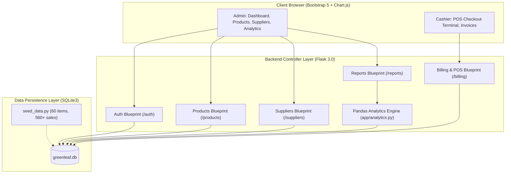
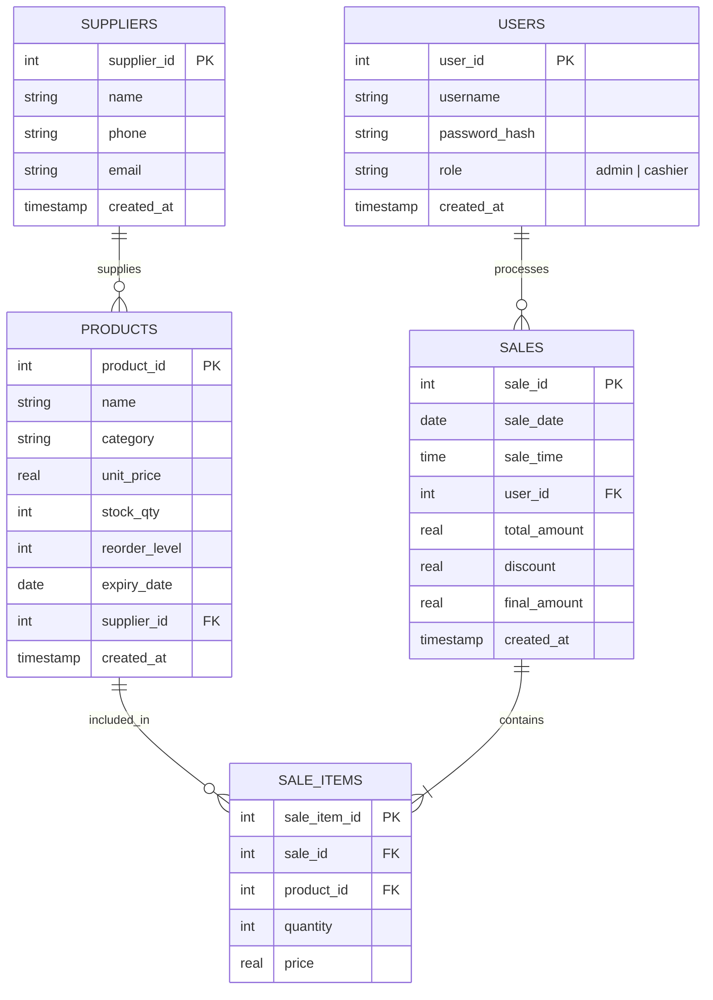

# GreenLeaf Grocers — Inventory & Sales Management System

[](https://www.python.org/)
[](https://flask.palletsprojects.com/)
[](https://www.sqlite.org/)
[](https://pandas.pydata.org/)
[](https://getbootstrap.com/)
[-success.svg)](test_report.md)

An end-to-end web application developed for **GreenLeaf Grocers** to solve paper-register inefficiencies, inventory stock-outs, perishable expiry losses, and lack of sales visibility. Built with **Python, Flask, SQLite, Pandas, and Chart.js**, featuring role-based access control (Admin vs. Cashier), real-time Point of Sale (POS) with atomic stock deduction, printable receipts, dynamic data filtering, and an executive data analytics dashboard.

---

## 📑 Table of Contents
1. [Key Features](#-key-features)
2. [System Architecture](#-system-architecture)
3. [Database Schema & ER Diagram](#-database-schema--er-diagram)
4. [Business Key Performance Indicators (KPIs)](#-business-key-performance-indicators-kpis)
5. [Tech Stack](#-tech-stack)
6. [Installation & Setup Guide](#-installation--setup-guide)
7. [Default Demo Credentials](#-default-demo-credentials)
8. [Automated Testing Suite](#-automated-testing-suite)
9. [Project Directory Structure](#-project-directory-structure)
10. [License](#-license)

---

## 🚀 Key Features

### 1. Role-Based Authentication & Navigation (RBAC)
- **Admin**: Full access to Executive Dashboard, Product CRUD, Supplier Directory, Sales Analytics, and CSV reporting.
- **Cashier**: Focused interface restricted strictly to the Point of Sale (POS) checkout terminal and personal sales receipt reprints.
- **Security**: Universal salted hashing (`werkzeug.security` with standard `hashlib.pbkdf2_hmac` fallback) and secure session management.

### 2. Product & Inventory Management
- **Full CRUD**: Add, edit, catalog, and remove grocery items across multiple categories (Produce, Dairy & Eggs, Bakery, Pantry, Snacks, Beverages).
- **Proactive Visual Alerts**:
  - 🔴 **Low-Stock Badge**: Flags items whose stock is $\le$ their reorder threshold.
  - 🟡 **Near-Expiry Countdown**: Dynamic clock badges calculating days remaining until product expiration ($\le 15$ days).
- **Defensive Validation**: Rejects negative prices, negative stock counts, and invalid date formats.
- **Bulk CSV Operations**: One-click catalog export and bulk CSV import with format validation.

### 3. Point of Sale (POS) & Billing Engine
- **Live Shopping Cart**: Interactive item picker with real-time subtotal, quantity adjustment, and promotional discount calculations.
- **Atomic Stock Deduction**: Processes multi-item checkouts inside single atomic SQLite transactions (`Sale.process_checkout()`), preventing overselling or partial records.
- **Cashier Tracking**: Automatically records cashier identity, timestamp, and line-item prices at the exact moment of sale.
- **Digital & Thermal Invoices**: Clean printable supermarket receipts (`@media print` CSS) and single-bill CSV downloads (`invoice_INV-XXXX.csv`).

### 4. Supplier Directory Management
- **Vendor Directory**: Full CRUD for agricultural suppliers and wholesale food distributors.
- **Catalog Linking**: Real-time counter badge showing active items supplied by each vendor.
- **Data Integrity**: Foreign key constraints set to `ON DELETE SET NULL` to preserve products when vendor contracts change.

### 5. Pandas Analytics Engine & Interactive Charts
- **5 Core Business KPIs**: Total Revenue, Average Bill Value, Stock Turnover Ratio, Low-Stock Count, and Top Category Market Share.
- **Chart.js Visualizations**:
  - 📈 **Sales Revenue Timeline**: Multi-series line chart tracking daily revenue fluctuations and customer bill volume.
  - 🍩 **Department Share**: Doughnut chart illustrating category revenue contribution and percentages.
  - 📊 **Top 10 Performing Products**: Horizontal bar chart with an **interactive client-side view toggle** switching between **`Revenue ($)`** and **`Units Sold`**.
- **Date Range Selector**: Custom start/end date filters with one-click quick presets (`Last 7D`, `Last 30D`, `Last 90D`, `All Time`).
- **Audit Reports**: Slow-Moving / Dead Inventory Watchlist to minimize inventory holding losses.

---

## 🏛 System Architecture



---

## 🗄 Database Schema & ER Diagram

The normalized SQLite database structure enforces foreign key integrity across 5 core tables:



---

## 📊 Business Key Performance Indicators (KPIs)

| KPI Name | Formula / Logic | Business Value |
| :--- | :--- | :--- |
| **Total Revenue** | $\sum \text{final\_amount}$ in period | Measures overall gross commercial performance. |
| **Average Bill Value** | $\frac{\text{Total Revenue}}{\text{Number of Bills}}$ | Tracks customer spending size per checkout visit. |
| **Stock Turnover Ratio** | $\frac{\text{Total Revenue}}{\text{Current Inventory Asset Value}}$ | Measures inventory velocity and capital efficiency. |
| **Low-Stock Items Count** | $\text{Count}(\text{stock\_qty} \le \text{reorder\_level})$ | Flags immediate replenishment requirements to prevent stock-outs. |
| **Top Category Share (%)** | $\frac{\text{Highest Department Revenue}}{\text{Total Revenue}} \times 100$ | Highlights sales concentration across grocery departments. |

---

## 🛠 Tech Stack

- **Backend Framework**: Python 3.10+, Flask 3.0+
- **Data Analytics Engine**: Pandas 2.2+, NumPy
- **Database**: SQLite3 (Foreign Keys enabled, Row factory mapping)
- **Frontend UI & Styling**: Bootstrap 5.3, Bootstrap Icons
- **Interactive Visualizations**: Chart.js 4.4.4 (UMD Bundle)
- **Testing & Verification**: Python standard library `unittest` (60 test cases)

---

## ⚙ Installation & Setup Guide

### 1. Clone or Open the Repository
```powershell
cd C:\Users\bsany\greenleaf-grocers
```

### 2. Activate Virtual Environment
```powershell
# Windows PowerShell
.\venv\Scripts\Activate.ps1
```

### 3. Install Dependencies
```powershell
pip install -r requirements.txt
```

### 4. Seed the Database
Populate 6 suppliers, 60 grocery products across 6 departments, and 560+ multi-month historical sales records:
```powershell
python seed_data.py
```

### 5. Run the Application
```powershell
python run.py
```
Open your browser and navigate to: **`http://127.0.0.1:5000`**

---

## 🔑 Default Demo Credentials

| Role | Username | Password | Accessible Modules |
| :--- | :--- | :--- | :--- |
| **Store Administrator** | `admin` | `admin123` | Dashboard, Products, Suppliers, POS, Sales Analytics, CSV Exports |
| **Senior Cashier** | `cashier1` | `cashier123` | POS Terminal, Invoices, Sales Audit History |

---

## 🧪 Automated Testing Suite

The application includes **60 automated unit tests** covering database constraints, authentication, product CRUD, atomic POS checkouts, Pandas analytics calculations, Chart.js views, and defensive edge-case handling.

### Run the Master Test Suite Runner:
```powershell
python run_all_tests.py
```

### Expected Output:
```text
========================================================================
  GREENLEAF GROCERS - COMPREHENSIVE SYSTEM TEST SUITE RUNNER
========================================================================
  tests.test_day1                [4/4 Passed]   (100.0%) -> PASSED
  tests.test_day2_auth           [7/7 Passed]   (100.0%) -> PASSED
  tests.test_day3_products       [9/9 Passed]   (100.0%) -> PASSED
  tests.test_day4_billing        [10/10 Passed] (100.0%) -> PASSED
  tests.test_day5_analytics      [10/10 Passed] (100.0%) -> PASSED
  tests.test_day6_charts         [10/10 Passed] (100.0%) -> PASSED
  tests.test_day7_edge_cases     [10/10 Passed] (100.0%) -> PASSED
------------------------------------------------------------------------
SUMMARY: 60 Tests Run | 0 Failures | 0 Errors | 0 Skipped
Overall Pass Rate: 100.0% | Total Duration: ~6.50s
========================================================================

[+] Comprehensive test report saved to: test_report.md
```

Individual test files can also be run independently:
```powershell
python -m unittest tests.test_day1
python -m unittest tests.test_day2_auth
python -m unittest tests.test_day3_products
python -m unittest tests.test_day4_billing
python -m unittest tests.test_day5_analytics
python -m unittest tests.test_day6_charts
python -m unittest tests.test_day7_edge_cases
```

---

## 📁 Project Directory Structure

```text
greenleaf-grocers/
├── app/
│   ├── routes/
│   │   ├── auth.py              # Login, Logout, Session lifecycle
│   │   ├── billing.py           # POS terminal, Checkout, Invoices, Bill CSV
│   │   ├── main.py              # Root router and Executive Dashboard
│   │   ├── products.py          # Product CRUD, category filters, CSV Import/Export
│   │   ├── reports.py           # Analytics hub, Chart data API, Report CSVs
│   │   └── suppliers.py        # Vendor directory and supplier CRUD
│   ├── templates/
│   │   ├── auth/login.html      # Distraction-free login portal
│   │   ├── billing/
│   │   │   ├── invoice.html     # Thermal-style printable receipt & CSV download
│   │   │   └── pos.html         # Live POS cart with dynamic calculations
│   │   ├── errors/
│   │   │   ├── 403.html         # Forbidden access page
│   │   │   ├── 404.html         # Not found error page
│   │   │   └── 500.html         # Internal server error page
│   │   ├── products/
│   │   │   └── index.html       # Inventory table with alert badges & modals
│   │   ├── reports/
│   │   │   └── index.html       # Visual analytics with Chart.js & toggle buttons
│   │   ├── suppliers/
│   │   │   └── index.html       # Supplier directory & contact management
│   │   ├── base.html            # Master layout with sidebar navigation
│   │   └── dashboard.html       # Executive Dashboard with preview charts
│   ├── static/
│   │   └── css/style.css        # Clean theme styling & custom card borders
│   ├── analytics.py             # Pandas KPI Engine and data aggregations
│   ├── auth_utils.py            # RBAC decorators (@login_required, @admin_required)
│   ├── database.py              # SQLite connection factory & schema DDL
│   ├── models.py                # Data models (User, Supplier, Product, Sale)
│   ├── utils.py                 # Password hashing & verification utilities
│   └── __init__.py              # Flask Application Factory & blueprint registry
├── tests/
│   ├── test_day1.py             # Schema, models & synthetic data tests
│   ├── test_day2_auth.py        # Authentication & RBAC enforcement tests
│   ├── test_day3_products.py    # Product CRUD & CSV import/export tests
│   ├── test_day4_billing.py     # POS billing engine & invoice tests
│   ├── test_day5_analytics.py   # Pandas KPI calculation & metrics tests
│   ├── test_day6_charts.py      # Chart.js rendering & view toggle tests
│   └── test_day7_edge_cases.py  # Defensive validation & error handler tests
├── config.py                    # Application configuration classes
├── requirements.txt             # Python project dependencies
├── run.py                       # WSGI entrypoint runner
├── run_all_tests.py             # Master test suite runner & report generator
├── seed_data.py                 # Synthetic grocery dataset generator (560+ sales)
├── test_report.md               # Automated test execution report
├── PROJECT_REPORT.md            # Comprehensive internship project report
├── DEMO_SCRIPT.md               # 5-minute live demo walkthrough presentation script
└── README.md                    # Project documentation & setup instructions
```

---

## 📄 License
This project was designed and built as part of the Python Developer / Data Analyst Internship program for GreenLeaf Grocers.